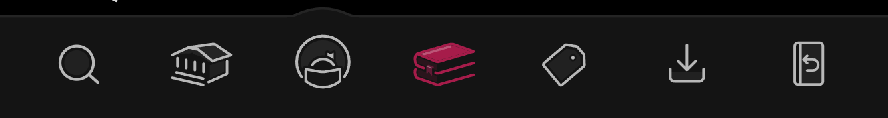
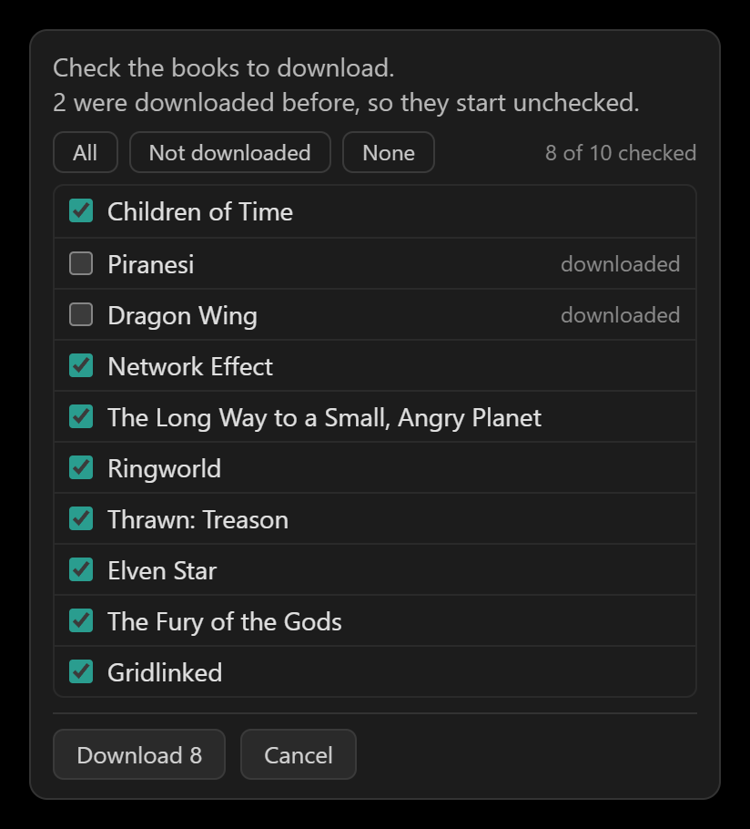
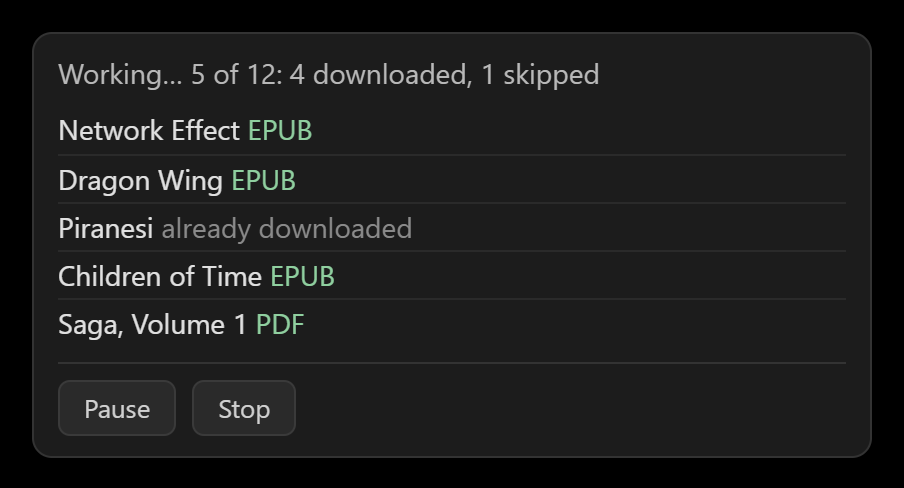
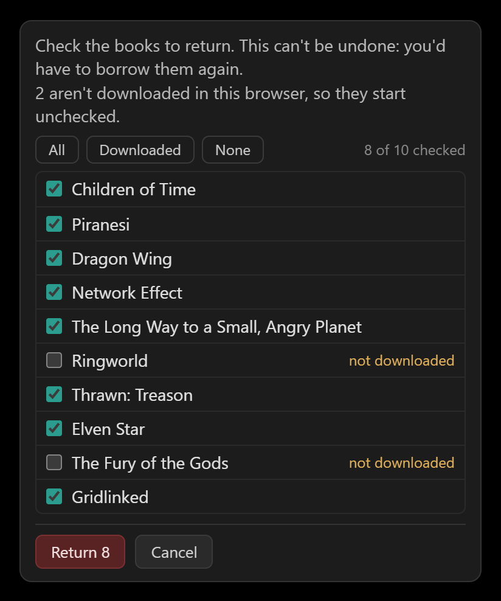
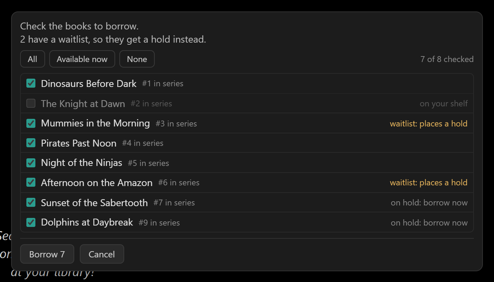
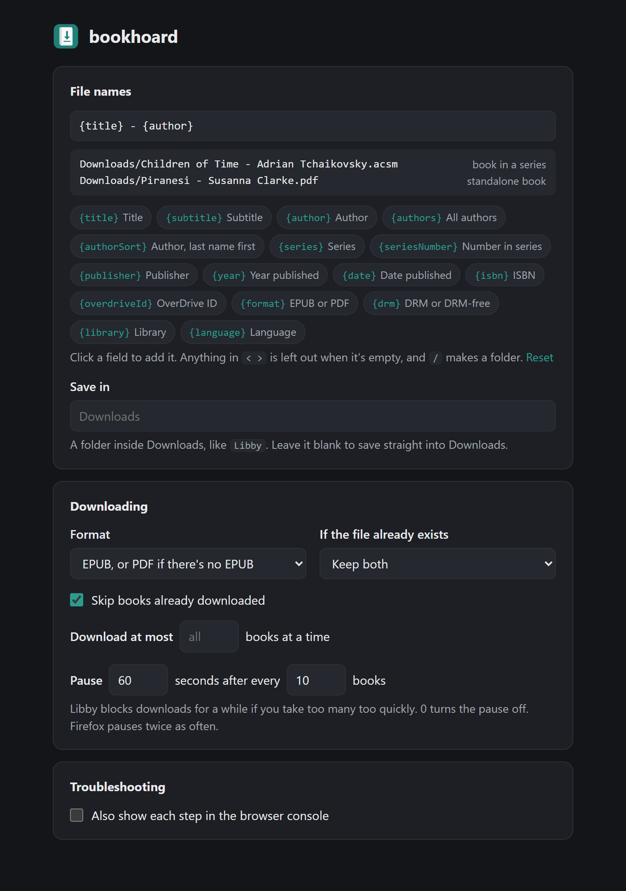

# bookhoard

Download all your Libby books at once, with proper file names. Return them all at once when
you're done. Borrow a whole series in one go.

bookhoard adds buttons to the bottom of Libby in your browser:

- **Download** saves every book you've borrowed, named like `Children of Time - Adrian Tchaikovsky`.
- **Return** sends back the books you pick.
- **Borrow** borrows the books listed on a page, like a whole series. It only shows on those pages.

## Install

Download the zip for your browser from the
[latest release](https://github.com/phillram/bookhoard/releases/latest).

**Chrome or Edge**

1. Unzip `bookhoard-…-chrome.zip` into a folder you'll keep, like `Documents\bookhoard`.
   Chrome runs bookhoard from that folder, so deleting it removes bookhoard.
2. Go to `chrome://extensions` (or `edge://extensions`) and turn on **Developer mode**.
3. Click **Load unpacked** and pick the folder.

To update, unzip the new version into the same folder and click the reload button on bookhoard.

**Firefox**

1. Go to `about:debugging#/runtime/this-firefox`.
2. Click **Load Temporary Add-on** and pick `bookhoard-…-firefox.zip`.

Firefox removes it when you close the browser, so you'll need to do this again next time.

## Download your books

1. Open your loans at [libbyapp.com/shelf/loans](https://libbyapp.com/shelf/loans).
2. Click **Download** at the bottom.
3. Check the books you want, then click **Download**. Books you haven't downloaded yet are already
   checked.
4. If your browser asks about downloading several files, click **Allow**.

A panel shows how it's going. You can **Pause** or **Stop** at any time.

Most books come as an `.acsm` file. Open it in
[Adobe Digital Editions](https://www.adobe.com/solutions/ebook/digital-editions.html) to get the
book itself. A few come as a plain `.epub` or `.pdf`, ready to read.

## Return your books

1. Click **Return** at the bottom.
2. Check the books to send back, then click **Return**.

Books you haven't downloaded yet start unchecked, so you don't return one by accident.

## Borrow a series

1. Open a book that's part of a series, or the series itself.
2. Click **Borrow** at the bottom. On a book's page, bookhoard opens its series first.
3. Check the books you want, then click **Borrow**. Books with a waitlist get a hold instead.

bookhoard uses whichever of your libraries has a copy now. If a library card needs verifying, it
tries your other libraries instead. If none of them can lend the book, it skips it and says so;
verify the card in Libby and run Borrow again for the rest.

If you already had one of the books on hold and bookhoard borrows it somewhere else, it cancels
that hold, so Libby doesn't lend you a second copy later.

Books none of your libraries have are listed as "not at your libraries". Check them (or click
**Notify me**) and bookhoard tags them with Libby's Notify Me, so Libby tells you if a library gets one.

## Options

Click the bookhoard icon in your browser's toolbar to choose how files are named, where they're
saved, and which format to get.

## Good to know

- Choosing EPUB or PDF locks that loan to the format until you borrow the book again. That's
  how Libby works.
- Audiobooks are skipped, and so are books Libby only lets you read in its app or on Kindle.
- Keep the Libby tab showing while bookhoard works. Browsers pause tabs in the background, so
  bookhoard waits and carries on when you come back. Its own window works, if you want to use
  other tabs meanwhile.
- After updating bookhoard, reload your Libby tab.
- bookhoard remembers what it has downloaded, even after you move the files, so those books start
  unchecked next time.

## Something not working?

Click **Copy log** on the panel (or **Copy last log** in the options, once the panel has closed)
and paste it into a
[new issue](https://github.com/phillram/bookhoard/issues). It lists your book titles and what
happened to each one, but not your download links.

## License

MIT
